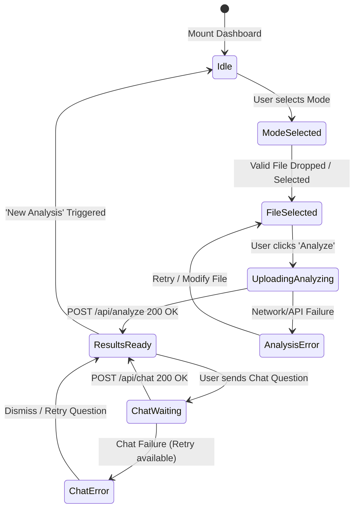

# OmniSolve AI — Technical Requirements Document (TRD)

**Document Version:** 1.0.0  
**Status:** Approved for Implementation  
**Frontend Lead:** Frontend Engineering  
**Backend & AI Lead:** Amay Raj (FastAPI + Gemma Model / LM Studio)  

---

## 1. System Architecture

OmniSolve AI follows a decoupled client-server architecture. The frontend is a single-page React application built with Vite and TypeScript. It communicates exclusively with Amay Raj's FastAPI backend through clean, RESTful endpoints.

```mermaid
graph TD
    subgraph Frontend [OmniSolve React + Vite + TypeScript Client]
        UI[UI Components & Workspace]
        HookLayer[Custom Hooks: useAnalysis, useChat]
        APIService[API Service Layer: api.ts]
        Validator[File & MIME Validation: fileValidation.ts]
    end

    subgraph Backend [FastAPI Backend Service - Amay Raj]
        Router[FastAPI Route Handlers]
        HealthCheck[/api/health]
        AnalyzeEndpoint[/api/analyze]
        ChatEndpoint[/api/chat]
        FileProcessor[File Processor & Parser: Image/PDF/Text]
        AIInferenceEngine[AI Inference Engine: Gemma 4 E4B / LM Studio / Gemini API]
    end

    UI --> HookLayer
    HookLayer --> APIService
    UI --> Validator
    APIService -->|HTTP Multipart / JSON| Router
    Router --> HealthCheck
    Router --> AnalyzeEndpoint
    Router --> ChatEndpoint
    AnalyzeEndpoint --> FileProcessor
    FileProcessor --> AIInferenceEngine
    ChatEndpoint --> AIInferenceEngine
```

**Security & Boundary Rule:**
The frontend never communicates directly with LM Studio or external model providers (e.g. Google Gemini API keys are never bundled into client assets). All inference runs strictly through the FastAPI backend.

---

## 2. Directory Structure

The frontend application adopts a modular, domain-driven structure:

```
omnisolve-ai/
├── PRD.md
├── TRD.md
├── design.md
├── README.md
├── .env.example
├── index.html
├── package.json
├── tsconfig.json
├── tsconfig.node.json
├── vite.config.ts
├── tailwind.config.js
├── postcss.config.js
└── src/
    ├── main.tsx
    ├── App.tsx
    ├── index.css
    ├── types/
    │   ├── analysis.ts          # Analysis types, mode enums, API models
    │   └── chat.ts              # Message payloads, chat sessions
    ├── config/
    │   └── supportedFiles.ts    # Configurable file types & max limits per mode
    ├── utils/
    │   ├── fileValidation.ts    # File extension & size validators
    │   └── formatters.ts        # Bytes formatting, text truncation
    ├── services/
    │   ├── api.ts               # Core HTTP client (Fetch API)
    │   └── mockData.ts          # Realistic mock fallbacks for isolated UI dev
    ├── hooks/
    │   ├── useAnalysis.ts       # Analysis lifecycle hook
    │   ├── useChat.ts           # Contextual chat lifecycle hook
    │   └── useBackendHealth.ts  # Backend connectivity check
    ├── components/
    │   ├── common/
    │   │   ├── Badge.tsx
    │   │   ├── Button.tsx
    │   │   ├── Card.tsx
    │   │   └── Tooltip.tsx
    │   ├── layout/
    │   │   ├── AppHeader.tsx    # Top navbar with status badge & actions
    │   │   └── AppSidebar.tsx   # Left navigation & mode switcher
    │   ├── dashboard/
    │   │   ├── WelcomeBanner.tsx
    │   │   ├── ModeSelectorCards.tsx
    │   │   └── SamplePrompts.tsx
    │   ├── upload/
    │   │   ├── FileUploadZone.tsx
    │   │   ├── FilePreviewCard.tsx
    │   │   └── FileValidationError.tsx
    │   ├── analysis/
    │   │   ├── AnalysisWorkspace.tsx
    │   │   ├── AnalysisHeader.tsx
    │   │   ├── StructuredResultViewer.tsx
    │   │   ├── CodeResultView.tsx
    │   │   ├── CircuitResultView.tsx
    │   │   ├── DocumentResultView.tsx
    │   │   ├── UncertaintyNotice.tsx
    │   │   └── LoadingAnalysisState.tsx
    │   └── chat/
    │       ├── ContextualChatPanel.tsx
    │       ├── ChatMessageItem.tsx
    │       ├── ChatInputBox.tsx
    │       └── SuggestedQuestions.tsx
```

---

## 3. API Contract Specification

### 3.1 Backend Health Check
- **Endpoint:** `GET /api/health`
- **Request Headers:** None
- **Response Format:**
```json
{
  "status": "ok",
  "model_available": true,
  "provider": "gemma-4-e4b"
}
```
*Frontend behavior:* If the endpoint returns non-200 or fails to connect, the header displays an offline warning pill and enables an optional "Mock UI Mode" toggle for development.

---

### 3.2 File Analysis
- **Endpoint:** `POST /api/analyze`
- **Content-Type:** `multipart/form-data`
- **Request Form Data:**
  - `file`: (Binary File, Required)
  - `analysis_type`: (String, Required) — `"code_debugger"` | `"circuit_analyzer"` | `"document_explainer"`
  - `question`: (String, Optional) — Specific query or context provided at upload time.

- **Response Format (200 OK):**
```json
{
  "session_id": "sess_89f3a2c4-17d9-4a0e-bc21-7299aef5817a",
  "analysis_type": "code_debugger",
  "summary": "TypeError: Cannot read properties of undefined (reading 'map') in React Component.",
  "findings": [
    "API response data is undefined on initial render prior to useEffect resolution.",
    "Component attempts to render items.map() directly without fallback or guard."
  ],
  "explanation": "In JavaScript, asynchronous data fetches initialize state as undefined or empty. When the JSX mounts before the promise fulfills, evaluating .map() on an undefined object triggers an unhandled TypeError.",
  "likely_problem": "Missing optional chaining (items?.map) or initial default state (useState([])).",
  "suggested_solution": "Initialize state with an empty array or apply optional chaining with a loading guard.",
  "solution_code": "const [items, setItems] = useState<Item[]>([]);\n\nif (isLoading) return <LoadingSpinner />;\nreturn <div>{items?.map(item => <ItemCard key={item.id} item={item} />)}</div>;",
  "steps": [
    "Verify the initial state assigned in useState(). Ensure it matches the expected array type.",
    "Add a loading check before mapping over the data.",
    "Use optional chaining `items?.map()` to safeguard against transient nullish states."
  ],
  "uncertainties": [
    "The full API response structure could not be inspected from the provided screenshot fragment.",
    "TypeScript definitions for Item could not be verified."
  ]
}
```

*Circuit Analyzer Variant:*
For `circuit_analyzer`, the response schema maps to:
- `components_identified`: Array of objects or strings `[{ "name": "555 Timer", "designator": "U1", "package": "DIP-8" }]`
- `apparent_function`: String summary of circuit behavior (e.g. Astable Multivibrator).
- `potential_issues`: Array of detected flaws (e.g., "Pin 4 (Reset) left floating").
- `steps`: Recommended physical diagnostic checks with multimeter or oscilloscope.

*Document Explainer Variant:*
For `document_explainer`, the response schema maps to:
- `summary`: High level executive summary.
- `key_concepts`: Core technical definitions and theoretical takeaways.
- `formulas_or_definitions`: Key formulas or equations extracted.
- `suggested_viva_questions`: Sample questions and suggested answers.

---

### 3.3 Contextual Chat
- **Endpoint:** `POST /api/chat`
- **Content-Type:** `application/json`
- **Request Payload:**
```json
{
  "session_id": "sess_89f3a2c4-17d9-4a0e-bc21-7299aef5817a",
  "question": "Can I use an empty array default in useState instead of a loading guard?",
  "analysis_type": "code_debugger"
}
```

- **Response Format (200 OK):**
```json
{
  "session_id": "sess_89f3a2c4-17d9-4a0e-bc21-7299aef5817a",
  "answer": "Yes, initializing useState([]) prevents the runtime crash because [].map() evaluates cleanly to an empty list without error. However, a loading guard is still recommended if you need to distinguish between 'no data found' and 'fetching in progress'."
}
```

*Note on Session Persistence:*
The frontend passes the `session_id` received from the `/api/analyze` response. If the backend fails to maintain session state or is undergoing local development, the frontend falls back gracefully to appending conversation history or using the local mock provider.

---

## 4. File Handling & Mode Validation Constraints

File extensions and MIME constraints are centrally managed in `src/config/supportedFiles.ts`:

| Mode | Allowed File Extensions | Allowed MIME Types | Max Size |
| :--- | :--- | :--- | :--- |
| **Code Debugger** | `.png`, `.jpg`, `.jpeg`, `.webp`, `.txt`, `.py`, `.js`, `.ts`, `.tsx`, `.jsx`, `.c`, `.cpp`, `.log` | `image/png`, `image/jpeg`, `image/webp`, `text/plain`, `text/x-python`, `application/javascript`, `text/x-c` | 15 MB |
| **Circuit Analyzer** | `.png`, `.jpg`, `.jpeg`, `.webp` | `image/png`, `image/jpeg`, `image/webp` | 15 MB |
| **Document Explainer**| `.pdf`, `.txt`, `.md` | `application/pdf`, `text/plain`, `text/markdown` | 15 MB |

### Client-side Validation Rules
1. Before setting state or uploading, check:
   - Is `file.size <= 15 * 1024 * 1024`?
   - Does `file.name` match allowed extensions for the active `AnalysisMode`?
2. If invalid: Reject file, set `validationError` with exact remedy (e.g. *"Circuit Analyzer currently only accepts schematic images (.png, .jpg, .webp). Please select Document Explainer for PDF manuals."*).
3. If valid: Clear any previous error, construct `URL.createObjectURL(file)` if image, and populate metadata.

---

## 5. Frontend State Management

Component state is kept lean and predictable using React local state and dedicated custom hooks:



### Hook Interfaces

#### `useAnalysis`
```typescript
interface UseAnalysisReturn {
  activeMode: AnalysisMode;
  setActiveMode: (mode: AnalysisMode) => void;
  selectedFile: File | null;
  filePreviewUrl: string | null;
  validationError: string | null;
  status: 'idle' | 'validating' | 'analyzing' | 'success' | 'error';
  result: AnalysisResult | null;
  sessionId: string | null;
  errorMessage: string | null;
  isMockMode: boolean;
  setIsMockMode: (val: boolean) => void;
  handleFileSelect: (file: File) => boolean;
  clearFile: () => void;
  runAnalysis: (customQuestion?: string) => Promise<void>;
  resetAll: () => void;
}
```

#### `useChat`
```typescript
interface UseChatReturn {
  messages: ChatMessage[];
  isWaiting: boolean;
  chatError: string | null;
  sendMessage: (text: string) => Promise<void>;
  resetChat: () => void;
}
```

---

## 6. Error Recovery & Boundary Handling

1. **Backend Unreachable (`TypeError: Failed to fetch`):**
   - Alert toast / banner displayed: *"Cannot connect to FastAPI backend at http://localhost:8000. Check if backend is running, or toggle Mock UI Mode to test the interface."*
2. **Analysis Timeout / Server Error (500):**
   - Provide "Retry Analysis" button without clearing the uploaded file.
3. **Chat Request Failure:**
   - Keep user message in chat, mark with a red retry icon, and display actionable error message without clearing the input text.
4. **Memory Management:**
   - Any `URL.createObjectURL` is explicitly revoked via `URL.revokeObjectURL(url)` in cleanup effects and during `clearFile()` / `resetAll()`.

---

## 7. Testing Strategy

1. **Unit Testing:**
   - File validation matrix (`fileValidation.test.ts`): Tests each extension against each mode.
   - Text formatter utilities (`formatters.test.ts`): Tests byte size formatting and truncation.
2. **Integration Verification:**
   - API client contract test: Verifies correct headers and FormData fields sent on `/api/analyze`.
   - Mock service parity: Ensures mock payload shapes strictly conform to `AnalysisResult` TypeScript interfaces.
3. **Responsive UI Verification:**
   - Desktop viewports ($\ge 1280px$): Three-panel split layout.
   - Mobile viewports ($375px - 767px$): Vertical stacking, collapsible chat drawer/tabs, touch-accessible buttons.
